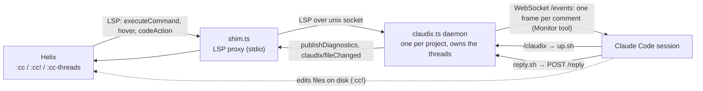

# claudix

Review code in Helix, talk to the Claude Code session that is writing it.

You leave threads on code ranges from inside Helix: questions, or change
requests that Claude applies immediately. Each thread shows up inline, is
readable in full through hover, is repliable in both directions, survives
edits (anchors move with the code), and lives exactly as long as the Claude
session that owns it.

```
●   2      let mut v = Vec::new();  ✓ why is this loop unbounded?  ↳ It never breaks. Cap it.
```

## How it works



- **Daemon**: started by `/claudix`, owns the threads. LSP over a unix socket,
  a WebSocket event feed, and a small HTTP API.
- **Helix**: attaches through `daemon/shim.ts`, a reconnecting LSP proxy, so
  daemon restarts are invisible. Threads are diagnostics, so Helix provides
  the UI: gutter marks, inline text, hover, `]d` / `[d`, pickers, code actions.
- **Claude**: watches the daemon with the Monitor tool, gets each comment as an
  event in the running session, and answers with one `curl` to `/reply`.
- **Steel** (`helix/claudix.scm`): turns a selection plus typed text into an
  LSP command, and reloads clean buffers when Claude edits a file.

## Install

This directory is part of the NixOS config and is wired up in `home/helix.nix`:

- `daemon/` is referenced from the store by `languages.toml` (the shim) and by
  the `/claudix` skill (the daemon). No `node_modules`: `lsp.ts` carries the
  framing, JSON-RPC, and text-document pieces, so Bun is the only runtime.
- `helix/claudix.scm` is installed as the Steel cog `claudix` through nhx's
  `plugins.claudix.package`, which also adds the `(require ...)` to `init.scm`.
- `skill/SKILL.md` becomes `~/.claude/skills/claudix/SKILL.md` with the daemon's
  store path substituted for `@daemon@`.
- `claudixLanguages` in `helix.nix` lists the languages the server attaches to,
  restating each language's default servers since `language-servers` replaces
  the default list.

Edits here need `nixos-rebuild switch`, then `/claudix` again in Claude Code
(the running daemon is the old build). Helix reattaches on its own.

## Use

1. In Claude Code, in the project: `/claudix`. Claude starts the daemon for
   that directory and arms the watcher. Re-run it any time to re-arm.
2. Open Helix in the same project. If Helix was already open: `:lsp-restart`.
3. Review:

| Command | Effect |
| --- | --- |
| select code, `:cc <text>` | new question thread on the selection |
| cursor inside a thread, `:cc <text>` | reply in that thread |
| `:cc! <text>` | ask Claude to make this change now (also a thread; Claude can decline and say why) |
| `:ccn <text>` | force a new thread even when the cursor is inside one |
| `:cc-resolve` | resolve the thread under the cursor |
| `:cc-status` | thread tally in the status line |
| `:cc-threads` | picker over open threads: type to filter, enter jumps there and opens the hover |
| `space k` on a thread | read the whole conversation |
| `space d` / `space D` | Helix diagnostics picker (jumps only; use `:cc-threads` for hover on select) |
| `]d` / `[d` | jump between threads |
| `space a` on a thread | code actions: resolve, ask Claude to apply |

A bare cursor with no thread under it comments on the whole line.

Thread glyphs: `?` open question, `!` open change request, `✓` answered,
`✓ applied`, `✗ declined`. `(code changed)` means you edited the anchored code
after commenting; the daemon re-anchors automatically when it can find the
original code again (for example after a reload).

Threads are published as zero-width diagnostics so Helix draws no squiggle
under the code; the gutter mark, inline marker, hover and `]d` still work.
Start the daemon with `--underline` to get the full range underlined.

## HTTP API (what Claude uses)

```
GET  /threads            tally and open threads
GET  /thread?id=t3       one thread with its current code
POST /reply              {"thread":"t3","text":"...","status":"answered|applied|declined"}
POST /resolve            {"thread":"t3"}
WS   /events             one text frame per comment / follow-up / resolve
```

The daemon writes `$XDG_RUNTIME_DIR/claudix/<project-hash>.json` with its
socket path, port, and pid. The shim finds the daemon for the directory Helix
was started in from those files. Override with `CLAUDIX_SOCK=<path>`.

## Development

```bash
bunx --bun tsc -p tsconfig.json --noEmit                      # type-check (bun-types from any bun project)
bun daemon/claudix.ts --project /some/dir --debug             # run by hand
bun test/lsp-client.ts /some/dir file.rs 'comment:10:40:question:why?' 'hover:1:2' status
./test/restart-scenario.sh /some/scratch                      # shim across daemon restarts
```

`test/lsp-client.ts` drives the shim the way Helix does, so you can exercise
the daemon without an editor. The scratch dir needs a `proj/` subdirectory.

## Limits

- Monitor watches expire after 30 minutes; the skill tells Claude to re-arm on
  expiry, and `/claudix` re-arms by hand.
- Threads are in memory. They end with the Claude session, by design.
- Comments are typed on the Helix command line, one line each. Hover renders
  Markdown replies fine, but your own comments are plain text.
